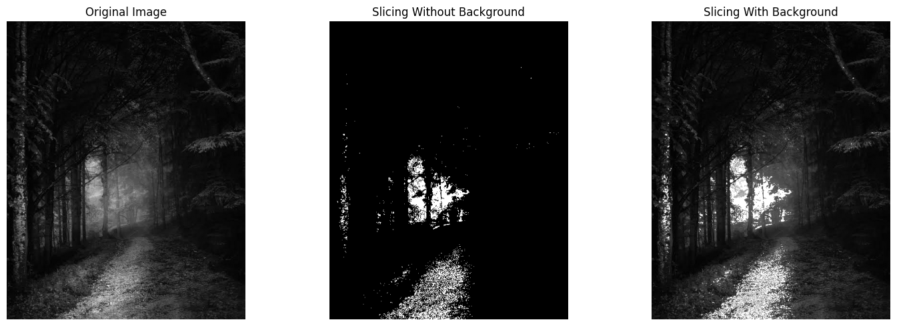
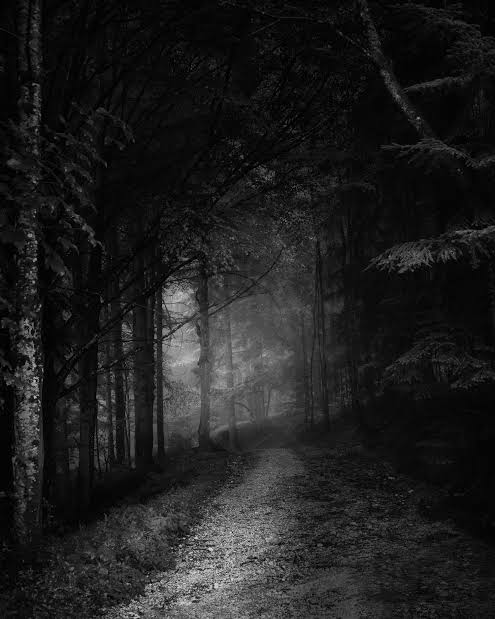

Gray Level Slicing Using OpenCV

Output

The output below shows the original input image and the results obtained using gray level slicing with and without background.

Results

Gray level slicing is an image enhancement technique used to highlight a specific range of gray levels in an image. It emphasizes the selected intensity range while either suppressing or preserving the remaining background.

Output Images

Input Image

Author

G. Balaji
